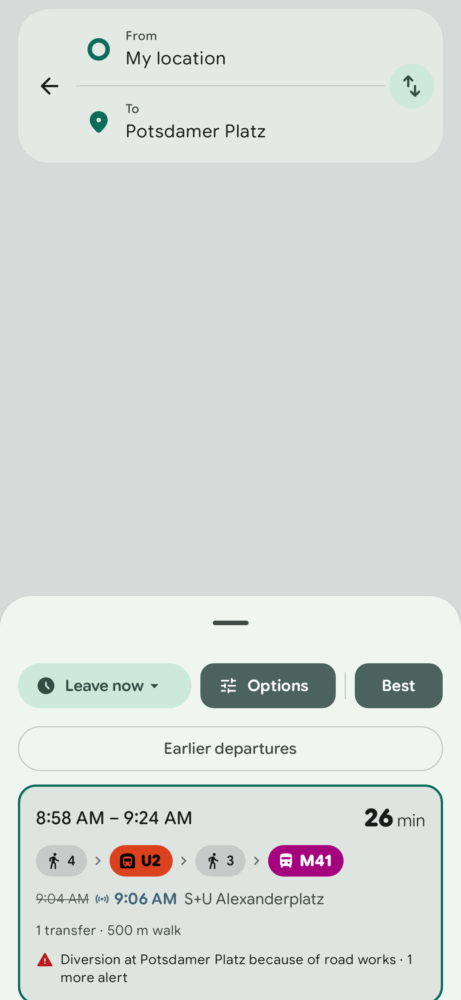
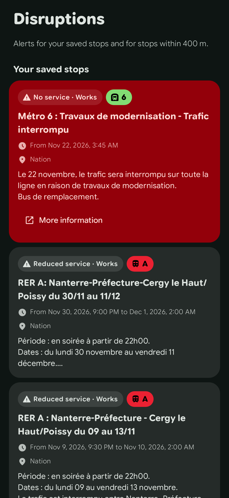
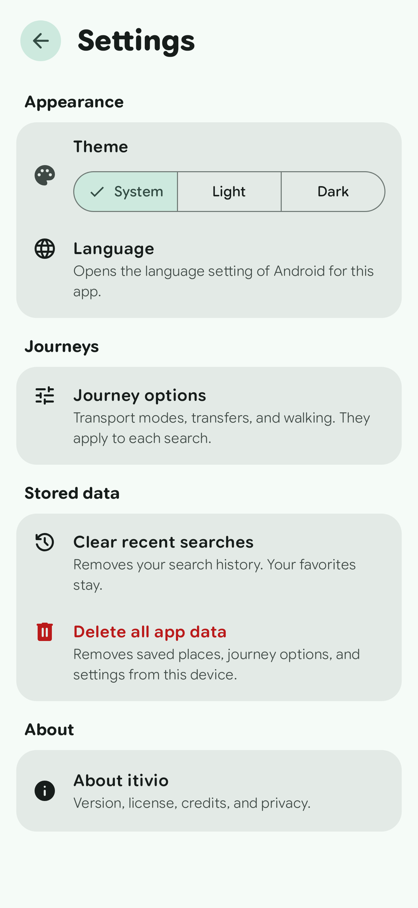

<p align="center">
  
</p>

<h1 align="center">itivio</h1>

<p align="center">
  <strong>A public transport app for Android that keeps your data on your device.</strong><br>
  <em>Plan journeys by bus, tram, metro, train, and ferry. Open source, no account, no ads.</em>
</p>

<p align="center">
  <a href="https://kotlinlang.org"></a>
  <a href="https://developer.android.com"></a>
  <a href="https://m3.material.io"></a>
  <a href="https://gradle.org"></a>
  <a href="https://github.com/kacigaya/itivio/blob/main/LICENSE"></a>
</p>

## Screenshots

Journey results in the light theme, disruptions in the dark theme, and settings in the light theme.

<p>
  
  
  
</p>

These images use test data from the [screenshot checks](docs/quality.md#screenshot-references). The native map is excluded.

## Features

- Map with your current location.
- Place and stop search with suggestions.
- Favorite places and stops, Home and Work shortcuts, and recent searches. They stay on your device.
- Departures from stops near you, with live countdowns.
- A departure board for each stop. Tap a stop on the map, or select "Show departures" for a stop in the search.
- Journey planning with all public transport modes. Leave now, leave at a time, or arrive by a time.
- Journey options: transport modes, a transfer limit, wheelchair-accessible routing, and walking speed. The app keeps them between starts.
- Earlier and later departures for each search.
- Sort routes by duration, transfers, or walking distance.
- Walk-only routes, when walking is a good choice.
- Service alerts on the route cards and in the journey details.
- Journey details: stops, platforms, times, and the route on the map. The trip tracker follows new delays while the details are open.
- Walking directions: the next turn, the distance to it, the remaining time, and the arrival time. The map follows your position and heading.
- The app keeps your search when Android stops it in the background, and plans it again.
- Live times where the transit agency publishes them. Scheduled times have no live marker.
- A Disruptions tab with the service alerts for your saved stops and for the stops near you.
- Settings for the theme and the journey options, and an action that deletes all app data.
- English and French.
- Light and dark themes with Material You colors.
- Layout for phones, tablets, and foldables.

## Privacy

Read the [privacy policy](PRIVACY.md) for details about location, network services, stored data, and deletion.

- No account, no analytics, no ads.
- The app does not log your journeys or your location.
- The app rounds the location it sends for search suggestions to about 1 km.
- Walking directions use your location on the device only. The app sends it only when you select "Plan a new route".
- Your location does not need Google Play services.
- Favorites, Home and Work, and recent searches are stored on your device. The Disruptions tab sends saved stop IDs as described below.
- Journey options stay on your device. They go to Transitous only as part of a journey request. This includes the wheelchair option.
- The Disruptions tab sends the IDs of your saved stops (Home, Work, and favorites) to Transitous, to get their alerts. It sends them only while the tab is open. A saved place that is not a stop is not sent.
- The settings stay on your device. "Delete all app data" in the settings removes the saved places, the journey options, and the settings.
- The app turns off Android backup and device transfer for its data.

The app sends requests to these services:

| Service | Use | Data sent |
|---|---|---|
| [Transitous](https://transitous.org/) | Search, routes, departures, disruptions, stops on the map, live trip times | Search text, start and end points of a journey, journey options, the IDs of the stops and trips you open, the IDs of your saved stops when you open the Disruptions tab, the map area you look at when you zoom in to street level |
| [IGN Géoplateforme](https://cartes.gouv.fr/) | French address search | Search text, without your location |
| [OpenFreeMap](https://openfreemap.org/) | Map tiles | The map area you look at |

## Data sources

Routing comes from [Transitous](https://transitous.org/), a community service that runs [MOTIS](https://github.com/motis-project/motis). Transitous combines timetables from many transit agencies. See the [list of data sources](https://transitous.org/sources/).

French address search also uses IGN Géoplateforme and the [Base Adresse Nationale](https://adresse.data.gouv.fr/). Address-like queries go to IGN when the first Transitous match identifies France. IGN failures leave Transitous suggestions available.

Map data © [OpenStreetMap](https://www.openstreetmap.org/copyright) contributors. Map tiles from [OpenFreeMap](https://openfreemap.org/). The map styles derive from [OSM Liberty](https://github.com/maputnik/osm-liberty) (BSD 3-Clause code, CC BY design) with [OpenMapTiles](https://openmaptiles.org/) data.

Coverage differs by region. Some regions have no live data.

## Build

Requirements: JDK 21 and the Android SDK (compile SDK 37).

```sh
./gradlew :app:assembleDebug
./gradlew :app:testDebugUnitTest
./gradlew :app:lintDebug
```

### APK builds on GitHub

Tests, lint, and the debug build run on each push and pull request. To download APKs, run the workflow manually:

1. Open [Build APK](https://github.com/kacigaya/itivio/actions/workflows/apk.yml).
2. Select **Run workflow** on `main`.
3. Wait for the build to pass.
4. Download `itivio-debug-apks` from the run's **Artifacts** section.
5. Extract the archive. Install the universal APK, or select the APK for your CPU type.

The workflow runs tests and lint before uploading the APKs. These are debug builds signed with a temporary debug key. Later builds can need a reinstall because the key can change. Artifacts expire after 14 days. A GitHub login is required to download them.

See [Quality checks](docs/quality.md) for screenshot references and the manual accessibility checks.

### Release builds

Run `./gradlew :app:assembleRelease` to build one APK per CPU type (`arm64-v8a`, `armeabi-v7a`, and `x86_64`) plus a universal APK.

Set all four environment variables to sign the release APKs:

- `ITIVIO_KEYSTORE`: path to the keystore file.
- `ITIVIO_KEYSTORE_PASSWORD`: keystore password.
- `ITIVIO_KEY_ALIAS`: signing key alias.
- `ITIVIO_KEY_PASSWORD`: signing key password.

You can also set `itivio.keystore`, `itivio.keystorePassword`, `itivio.keyAlias`, and `itivio.keyPassword` in `~/.gradle/gradle.properties`. Environment variables take priority. If any value is missing, the release APKs stay unsigned. Keep keys and passwords outside the repository.

### Transitous contact

Transitous asks each app to send contact details with every request. The app puts the `itivio.contact` Gradle property in its User-Agent. If you publish a fork, change the contact to your own:

```sh
./gradlew :app:assembleRelease -Pitivio.contact=you@example.com
```

Read the [Transitous usage policy](https://transitous.org/api/) before you publish a fork. The service is for open-source, non-commercial apps only.

## Contributing and security

Read [Contributing](CONTRIBUTING.md) for setup and checks. See the [changelog](CHANGELOG.md) for version history and the [security policy](SECURITY.md) to report a vulnerability.

## License

itivio is free software. You can redistribute it and change it under the terms of the [GNU General Public License](LICENSE), version 3 or any later version.

The app bundles the Google Sans Flex typeface, unmodified. It has its own license, the [SIL Open Font License 1.1](licenses/GoogleSansFlex-OFL.txt). The icons are Material Symbols, under the Apache License 2.0.
