<!-- Image assets under assets/readme/:
  banner.svg
  light/ + dark/: btn-download.svg, btn-website.svg, btn-source.svg, btn-privacy.svg,
    badge-adfree.svg, badge-private.svg, badge-android.svg, badge-m3e.svg, badge-gpl.svg,
    h-screenshots.svg, hm-screenshots.svg, h-features.svg, hm-features.svg, h-install.svg, hm-install.svg,
    h-build.svg, hm-build.svg, h-privacy.svg, hm-privacy.svg, h-faq.svg, hm-faq.svg,
    card-plan.svg, card-board.svg, card-live.svg, card-walk.svg, card-alerts.svg, card-private.svg
  shots/: 01-home.png, 02-search.png, 03-results.png, 04-itinerary.png, 05-walk.png, 06-disruptions.png
-->

<div align="center">

<br><br>
<p align="center">
  <a href="https://github.com/kacigaya/itivio/releases"></a>
  <a href="https://github.com/kacigaya/itivio/blob/main/LICENSE"></a>
  <a href="https://kotlinlang.org"></a>
  <a href="https://developer.android.com"></a>
  <a href="https://m3.material.io"></a>
</p>
<p align="center">
<a href="https://github.com/kacigaya/itivio/releases"><picture><source media="(prefers-color-scheme: dark)" srcset="assets/readme/dark/btn-download.svg"></picture></a>
<a href="https://kacigaya.github.io/itivio/"><picture><source media="(prefers-color-scheme: dark)" srcset="assets/readme/dark/btn-website.svg"></picture></a>
<a href="https://github.com/kacigaya/itivio"><picture><source media="(prefers-color-scheme: dark)" srcset="assets/readme/dark/btn-source.svg"></picture></a>
<a href="PRIVACY.md"><picture><source media="(prefers-color-scheme: dark)" srcset="assets/readme/dark/btn-privacy.svg"></picture></a>
</p>

<p align="center">
<picture><source media="(prefers-color-scheme: dark)" srcset="assets/readme/dark/badge-adfree.svg"></picture>
<picture><source media="(prefers-color-scheme: dark)" srcset="assets/readme/dark/badge-private.svg"></picture>
<picture><source media="(prefers-color-scheme: dark)" srcset="assets/readme/dark/badge-android.svg"></picture>
<picture><source media="(prefers-color-scheme: dark)" srcset="assets/readme/dark/badge-m3e.svg"></picture>
<picture><source media="(prefers-color-scheme: dark)" srcset="assets/readme/dark/badge-gpl.svg"></picture>
</p>

</div>

itivio is an open-source Android app for public transport that keeps your data on your device. Plan journeys by bus, tram, metro, train, and ferry — no account, no ads, no analytics.

Routing comes from [Transitous](https://transitous.org/), a community service. Coverage differs by region, and some regions have no live data. The interface uses Material 3 Expressive with light and dark themes and Material You colors, in English and French, on phones, tablets, and foldables.

<h3 id="screenshots"><picture><source media="(prefers-color-scheme: dark) and (max-width: 640px)" srcset="assets/readme/dark/hm-screenshots.svg"><source media="(prefers-color-scheme: dark)" srcset="assets/readme/dark/h-screenshots.svg"><source media="(max-width: 640px)" srcset="assets/readme/light/hm-screenshots.svg"></picture></h3>
<div align="center">
<a href="https://github.com/kacigaya/itivio/releases/download/v0.10.1/demo.mp4"></a>
</div>
<div align="center">
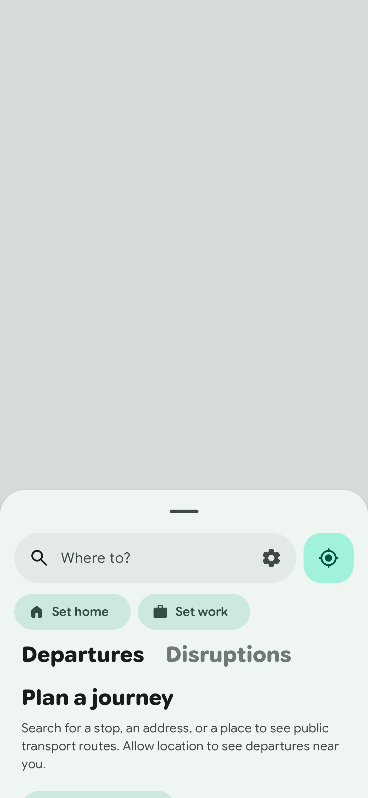
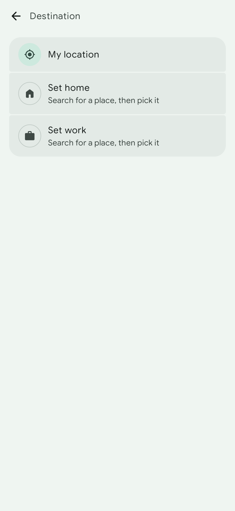
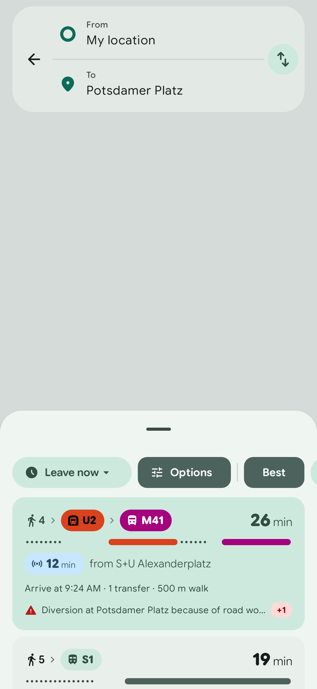
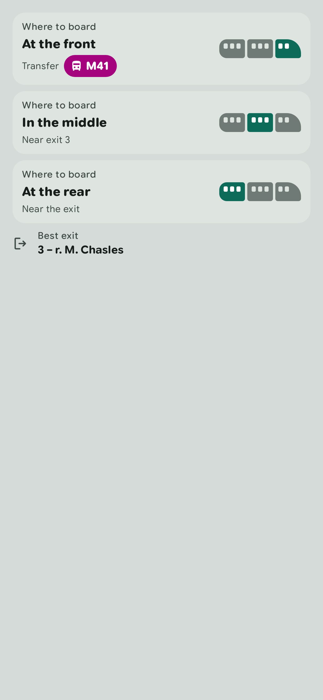
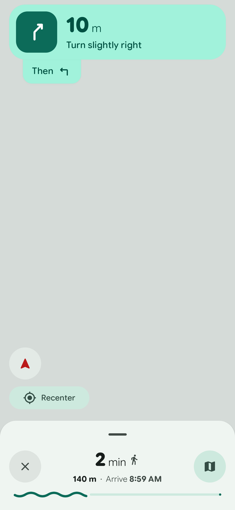
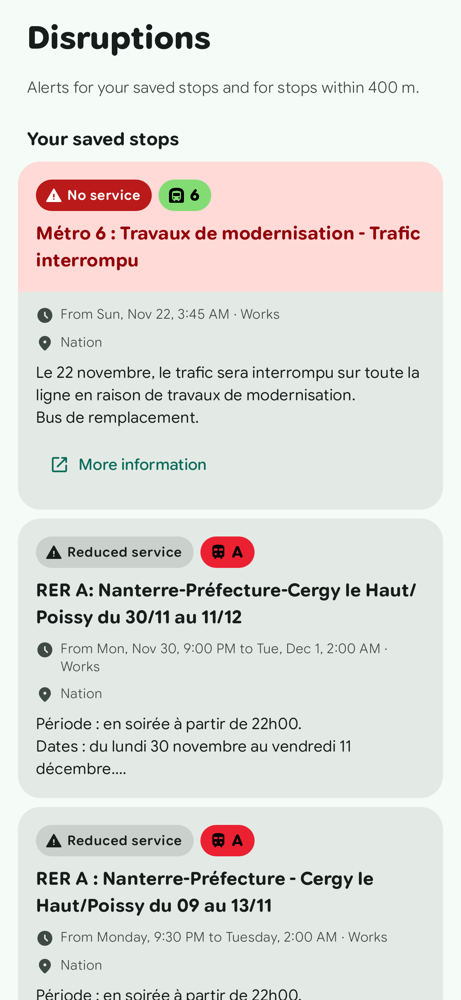
</div>

<h3 id="features"><picture><source media="(prefers-color-scheme: dark) and (max-width: 640px)" srcset="assets/readme/dark/hm-features.svg"><source media="(prefers-color-scheme: dark)" srcset="assets/readme/dark/h-features.svg"><source media="(max-width: 640px)" srcset="assets/readme/light/hm-features.svg"></picture></h3>

<details>
<summary><b>Technical specifications (expand)</b></summary>

- **Core platform**: 100% Kotlin 2.4.21, AGP 9.5.2, Gradle 9.9.2, JDK 21. Compile SDK 37.2, min SDK 26 (Android 8.0).
- **UI & design**: Jetpack Compose, Material 3 Expressive, Navigation 3. Dynamic color (Material You) on Android 12+, fallback tonal-spot scheme from `#1B6B5A`. Light and dark themes, English and French, layouts for phones, tablets, and foldables.
- **Maps**: MapLibre with OpenFreeMap tiles; custom light and dark styles derived from OSM Liberty.
- **Networking**: Ktor (OkHttp engine) with kotlinx.serialization, against the MOTIS 2 API of Transitous; IGN Géoplateforme for French address search.
- **Storage**: Room with KSP for saved places; Preferences DataStore for journey options and settings.
- **DI & async**: Koin; coroutines and StateFlow.
- **Boarding data**: offline tables built from the RATP / Île-de-France Mobilités datasets, shipped inside the APK. No request for them.
- **License & requirements**: free and open source under GNU GPL v3.0 or later. No account, no ads, no analytics. Android 8.0 or later.

</details>

<div align="center">
<picture><source media="(prefers-color-scheme: dark)" srcset="assets/readme/dark/card-plan.svg">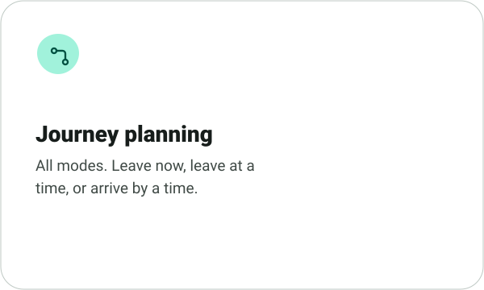</picture>
<picture><source media="(prefers-color-scheme: dark)" srcset="assets/readme/dark/card-board.svg">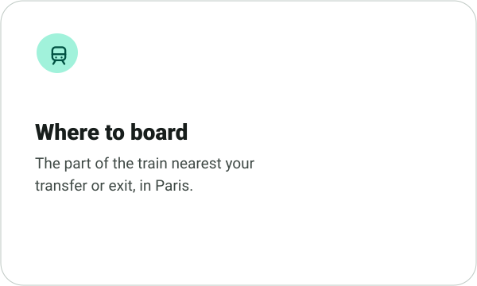</picture>
<picture><source media="(prefers-color-scheme: dark)" srcset="assets/readme/dark/card-live.svg">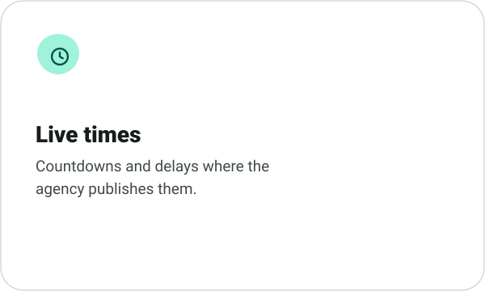</picture>
<picture><source media="(prefers-color-scheme: dark)" srcset="assets/readme/dark/card-walk.svg">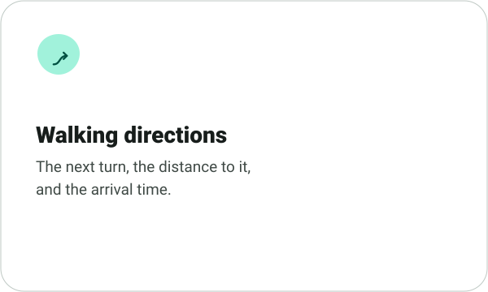</picture>
<picture><source media="(prefers-color-scheme: dark)" srcset="assets/readme/dark/card-alerts.svg">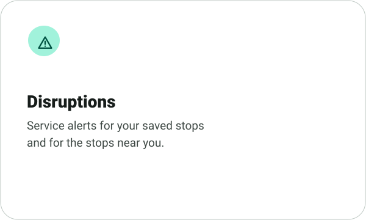</picture>
<picture><source media="(prefers-color-scheme: dark)" srcset="assets/readme/dark/card-private.svg">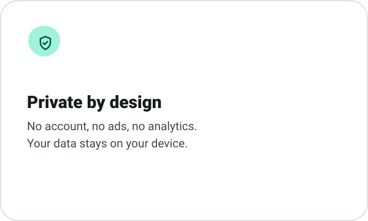</picture>
</div>

<details>
<summary><b>All features (expand)</b></summary>

- Map with your current location.
- Place and stop search with suggestions.
- Favorite places and stops, Home and Work shortcuts, and recent searches. They stay on your device.
- Departures from stops near you, with live countdowns.
- A departure board for each stop. Tap a stop on the map, or select "Show departures" for a stop in the search.
- Journey planning with all public transport modes. Leave now, leave at a time, or arrive by a time.
- Journey options: transport modes, a transfer limit, wheelchair-accessible routing, and walking speed. The app keeps them between starts.
- Routes grouped by line, with the next departures of each route.
- Sort routes by duration, transfers, or walking distance.
- Walk-only routes, when walking is a good choice.
- Service alerts on the route cards and in the journey details.
- Journey details: stops, platforms, times, and the route on the map. Departure skeletons show while the boarding hints and train lists load. They appear together. The trip tracker follows new delays while the details are open.
- Recent journey results and live times stay in memory for 30 seconds, so screens can reopen without a loading wait.
- Where to board the metro in Paris: the part of the train that stops nearest to your transfer or exit. Show the exit number and name below the arrival stop. The app picks the exit nearest to your destination. This is an estimate and does not check street access or lifts. The data ships with the app, so it sends no request.
- Walking directions: the next turn, the distance to it, the remaining time, and the arrival time. The map follows your position and heading.
- The app keeps your search when Android stops it in the background, and plans it again.
- Live times where the transit agency publishes them. Scheduled times have no live marker.
- A Disruptions page on the home screen with the service alerts for your saved stops and for the stops near you. A swipe changes between departures and disruptions.
- Settings for the theme and the journey options, and an action that deletes all app data.
- English and French.
- Light and dark themes with Material You colors.
- Layout for phones, tablets, and foldables.

</details>

<h3 id="install"><picture><source media="(prefers-color-scheme: dark) and (max-width: 640px)" srcset="assets/readme/dark/hm-install.svg"><source media="(prefers-color-scheme: dark)" srcset="assets/readme/dark/h-install.svg"><source media="(max-width: 640px)" srcset="assets/readme/light/hm-install.svg"></picture></h3>

Download the APK from the [newest release](https://github.com/kacigaya/itivio/releases). The universal APK works on all devices. The app needs Android 8.0 or later.

Releases from v0.14.0 on are signed with the project key. The SHA-256 fingerprint of its certificate is:

```
E7:15:4A:73:3D:EF:B1:DC:B6:8A:80:FD:C8:35:56:FF:88:B4:EA:2F:83:6D:36:A3:30:6A:DF:A0:C6:8A:29:81
```

To check a download, compare it with `SHA256SUMS.txt` of the release, or run `apksigner verify --print-certs` on the APK.

<details>
<summary><b>Update from v0.13.1 or earlier</b></summary>

Versions up to v0.13.1 used a debug key. Android cannot update an app to a version with another key, so this change needs one reinstall:

1. Uninstall itivio. This deletes your saved places, recent searches, and settings.
2. Install v0.14.0 or later.
3. Set your Home, Work, and favorites again.

Later releases update in place.

</details>

<h3 id="build"><picture><source media="(prefers-color-scheme: dark) and (max-width: 640px)" srcset="assets/readme/dark/hm-build.svg"><source media="(prefers-color-scheme: dark)" srcset="assets/readme/dark/h-build.svg"><source media="(max-width: 640px)" srcset="assets/readme/light/hm-build.svg"></picture></h3>

Requirements: JDK 21 and the Android SDK (compile SDK 37).

```sh
git clone https://github.com/kacigaya/itivio.git
cd itivio
./gradlew :app:assembleDebug
./gradlew :app:testDebugUnitTest
./gradlew :app:lintDebug
```

<details>
<summary><b>Project structure, CI, and release signing</b></summary>

- Layers: `ui/` (Compose screens, ViewModels, theme), `domain/` (models and repository contracts), `data/` (Transitous client, Room, DataStore, Koin bindings in `DataModule.kt`). `ui` never imports `data`.
- CI: `.github/workflows/apk.yml` runs tests, lint, and the debug build on each push and pull request. A manual run also uploads `itivio-debug-apks` for 14 days. Those are debug-signed with a temporary key, so later builds can need a reinstall. See [docs/quality.md](docs/quality.md) for the screenshot references and manual accessibility checks.
- Release builds: `./gradlew :app:assembleRelease` builds one APK per CPU type (`arm64-v8a`, `armeabi-v7a`, `x86_64`) plus a universal APK. Set `ITIVIO_KEYSTORE`, `ITIVIO_KEYSTORE_PASSWORD`, `ITIVIO_KEY_ALIAS`, and `ITIVIO_KEY_PASSWORD` (or `itivio.keystore`, `itivio.keystorePassword`, `itivio.keyAlias`, `itivio.keyPassword` in `~/.gradle/gradle.properties`; environment variables take priority). If any value is missing, the release APKs stay unsigned. Keep keys outside the repository. A `vX.Y.Z` tag runs [release.yml](.github/workflows/release.yml): tests, lint, the signed build, a signature check, and publishing with `SHA256SUMS.txt`. The tag must match `versionName`, and `CHANGELOG.md` must have a section for the version.
- Website: `site/` is the project website, a static Next.js export that links the newest release. `.github/workflows/pages.yml` deploys it to GitHub Pages.
- Transitous contact: every request sends a User-Agent with the `itivio.contact` Gradle property. If you publish a fork, change it: `./gradlew :app:assembleRelease -Pitivio.contact=you@example.com`. Read the [Transitous usage policy](https://transitous.org/api/) first — the service is for open-source, non-commercial apps only.

</details>

<h3 id="privacy"><picture><source media="(prefers-color-scheme: dark) and (max-width: 640px)" srcset="assets/readme/dark/hm-privacy.svg"><source media="(prefers-color-scheme: dark)" srcset="assets/readme/dark/h-privacy.svg"><source media="(max-width: 640px)" srcset="assets/readme/light/hm-privacy.svg"></picture></h3>

Read the [privacy policy](PRIVACY.md) for details about location, network services, stored data, and deletion.

- No account, no analytics, no ads. The app does not log your journeys or your location.
- The location sent for search suggestions is rounded to about 1 km. Walking directions use your location on the device only, and send it only when you select "Plan a new route".
- Your location does not need Google Play services. Android backup and device transfer are turned off for the app data.
- Favorites, Home and Work, recent searches, journey options, and settings stay on your device. The disruptions list sends the IDs of your saved stops to Transitous, while the home screen is open on a phone, because it shows the number of alerts.

The app sends requests to these services only:

| Service | Use | Data sent |
|---|---|---|
| [Transitous](https://transitous.org/) | Search, routes, departures, disruptions, stops on the map, live trip times | Search text, start and end points of a journey, journey options, the IDs of the stops and trips you open, the IDs of your saved stops for the disruptions list, the map area you look at when you zoom in to street level |
| [IGN Géoplateforme](https://cartes.gouv.fr/) | French address search | Search text, without your location |
| [OpenFreeMap](https://openfreemap.org/) | Map tiles | The map area you look at |

<h3 id="faq"><picture><source media="(prefers-color-scheme: dark) and (max-width: 640px)" srcset="assets/readme/dark/hm-faq.svg"><source media="(prefers-color-scheme: dark)" srcset="assets/readme/dark/h-faq.svg"><source media="(max-width: 640px)" srcset="assets/readme/light/hm-faq.svg"></picture></h3>

<details>
<summary><b>Frequently Asked Questions (FAQ)</b></summary>
<br>

* **Is itivio really free?** Yes. Open source under GNU GPL v3.0 or later, with no ads, no analytics, and no account.
* **Can I use it without location access?** Yes. Location is optional: you can search and plan journeys without it.
* **Does it need Google Play services?** No. Location comes from the Android framework provider.
* **What leaves my phone?** Only the requests in the privacy table above. Favorites, recent searches, settings, and journey options stay on the device.
* **Where does "where to board" come from?** The RATP / Île-de-France Mobilités datasets, shipped as offline tables in the APK. It covers Paris metro platforms and some RER platforms; other regions show no boarding hint.
* **Why does coverage differ by region?** Routing comes from Transitous, a community service that combines agency timetables. Some regions have no live data; scheduled times then show without a live marker.
* **How do I verify a download?** Compare it with `SHA256SUMS.txt` of the release, or run `apksigner verify --print-certs` and check the fingerprint above.

</details>

## CREDITS

Routing: [Transitous](https://transitous.org/), a community [MOTIS](https://github.com/motis-project/motis) service — see the [list of data sources](https://transitous.org/sources/). French addresses: IGN Géoplateforme, [Base Adresse Nationale](https://adresse.data.gouv.fr/). Boarding positions and exits in Paris: the RATP datasets [Positionnement dans la rame](https://prim.iledefrance-mobilites.fr/fr/jeux-de-donnees/positionnement-dans-la-rame) and [Accès](https://data.iledefrance-mobilites.fr/explore/dataset/acces/) from Île-de-France Mobilités, under the Licence Ouverte 2.0; `tools/boarding-positions.py` builds the offline tables. Map data © [OpenStreetMap](https://www.openstreetmap.org/copyright) contributors. Map tiles from [OpenFreeMap](https://openfreemap.org/). Map styles derive from [OSM Liberty](https://github.com/maputnik/osm-liberty) (BSD 3-Clause code, CC BY design) with [OpenMapTiles](https://openmaptiles.org/) data.

itivio is licensed under the **GNU General Public License, version 3 or later** ([LICENSE](LICENSE)). The app bundles the Google Sans Flex typeface, unmodified, under the [SIL Open Font License 1.1](licenses/GoogleSansFlex-OFL.txt). The icons are Material Symbols, under the Apache License 2.0.

Contributing: see [CONTRIBUTING.md](CONTRIBUTING.md). Version history is in [CHANGELOG.md](CHANGELOG.md). To report a vulnerability, follow [SECURITY.md](SECURITY.md).

<sub>Search terms: itivio, Android public transport app, open-source transit app, bus tram metro train ferry, privacy-focused, no ads no analytics, on-device data, Transitous MOTIS, Material 3 Expressive, GPL-3.0.</sub>
